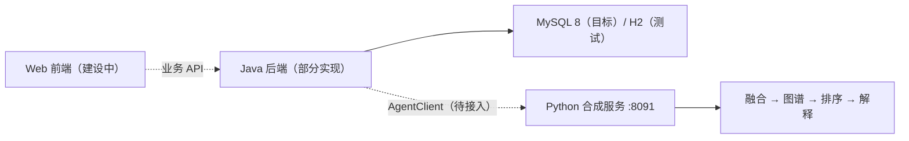

# AD-CausalRisk

面向阿尔茨海默病风险研究与课程协作的多源数据、条件图谱和可解释排序项目。

[](https://github.com/yanxiao07/AD-CausalRisk/actions/workflows/python-base.yml?query=branch%3Amain)
[](https://github.com/yanxiao07/AD-CausalRisk/actions/workflows/backend-build.yml?query=branch%3Amain)

[快速开始](#快速开始) · [项目状态](#项目状态) · [文档导航](#文档导航) · [参与贡献](#参与贡献) · [路线图](#路线图)

AD-CausalRisk 将资料整理、质量检查、图谱、排序和解释组织为可追溯的工作流。Python 提供可独立运行的合成数据服务；Java 承担业务 API、权限与持久化；前端面向研究人员、医生和患者提供相应视图。

研究主线固定为**多源数据融合 → 个体化因果图谱构建 → 因果引导的预警模型建立 → 个体化可解释性分析**。后续任务按[四环节研究与推进规范](docs/Research_Core_Principles.md)对应缺口、复用已有成果并设置验收终点；该目标不表示个体因果结构、图增益或临床用途已经成立。

第2→3环节[固定三臂图预测研究](docs/Graph_Research_Execution.md)已完成54真实训练/模型交付，未确立固定先验增益；第4环节[图解释诊断](docs/Graph_Explanation_Results.md)已复用45外折模型完成数值重构/实际路径与敏感性验收。贡献顺序敏感，未建立严格个人因果或稳定/临床解释。

**项目正在开发中。** 当前课程服务使用明确标记的合成数据与固定加性规则，输出用于教学和工程联调。排序分数不是经临床验证的个体患病概率，图谱箭头不代表已识别的因果或治疗效应。

七变量三算法及固定遗传/横断MRI的离线训练与对照已有阶段交付；新模型尚未替换当前业务服务。研究完成范围、Git交付内容及Java如何取数调用Python，见[研究交付与接入说明](docs/Research_Progress_and_Integration.md)。

可移植估计器、人月/CIF、已保存模型的离线合成验收，以及固定五外折/三内折训练与嵌套校准，见[研究模型Python接入准备](docs/Research_Model_Portability.md)与[运行说明](research_runtime/README.md)。该可选模块使用独立依赖，计算源码随本分支交付；历史队列构造、全部比较/解释流水线、新模型HTTP服务和Java业务联调继续单独验收。

本分支新增[分组Shapley/LIME及表格编排](docs/Table_Grouped_Study_Execution.md)、[输入声明一致性校验](docs/Real_Input_Admission.md)与[单次内存CIF调用](docs/InMemory_Research_Inference.md)。方法、构造验收和真实研究结论分别报告；不加入受控数据/权重，不改变共享HTTP或默认模型。

## 核心能力

- **资料与质量**：三表 CSV 预检、档案关联、日期与单位检查、缺失/重复/冲突定位，以及严重问题阻断。
- **四阶段工作流**：`DATA_FUSION → CAUSAL_GRAPH → WARNING_MODEL → EXPLANATION`，保留原值、来源时间、版本、实际阶段与耗时。
- **可追溯解释**：原图模板、图到评分输入的门控、逐项贡献与截断/舍入重构，以及说明文字的语义校验。
- **联调与故障处理**：版本化 HTTP 契约、标准库客户端、易失缓存重放、故障案例、只读恢复和合成批处理。
- **研究工程工具**：纵向特征矩阵、缺失输入敏感性、合成解释一致性和构造概率评估；各工具的适用范围见对应文档。

## 项目状态

以下为当前分支的实现范围；完整验收条件以[课程需求](docs/Course_SRS_V3_2.md)为准。顶部徽章展示 `main` 分支的 CI，功能分支的检查结果请查看对应提交或 PR。

2026-10-27本分支从main `94f9789`建立；[Python研究源码PR #13](https://github.com/yanxiao07/AD-CausalRisk/pull/13)及[后端/业务前端PR #11](https://github.com/yanxiao07/AD-CausalRisk/pull/11)已合并。[登录页PR #12](https://github.com/yanxiao07/AD-CausalRisk/pull/12)仍开放且与当前main冲突；本分支不修改其前端实现。业务联合验收依然以对应模块实际证据为准。

| 模块 | 已有实现 | 后续工作 |
| --- | --- | --- |
| Python | 合成四阶段服务、输入与结果校验、质量阻断、融合/图/贡献追溯、客户端和工程工具 | 按实际 Java 接入反馈完成联调；真实研究模型与临床验证单独验收 |
| Java 后端 | Spring Boot 工程、数据库迁移、认证、档案、访视及 CSV 预览/确认入库；目标契约 22 个操作中已实现 10 个，另实现质控（QC）扩展模块（审核队列列表、审核决策提交、状态统计）| 特征读取、持久化任务、AgentClient、结果、复核、随访、报告和审计等，详见[后端说明](backend/README.md) |
| Web 前端 | main已包含PR #11引入的Vue工程及部分认证、档案/导入等页面 | 完整业务页面、对象权限状态、实际联调与交互验收仍需完成；登录页PR #12尚未合并，详见[前端说明](frontend/README.md) |
| 全链路 | 契约、合成样例和分模块检查 | 实际 Java → Python 调用、业务保存、患者字段过滤及重启历史查询的联合验收 |

接口目标、数据库表或页面片段的存在不表示对应业务已完成。Python 工程测试也不替代 Java、MySQL 或浏览器端到端验收。

## 快速开始

先运行 Python 合成服务，完成一次请求与查询。该流程不需要 Java、数据库或研究数据。文档与运行源码应来自同一分支。

### 环境要求

| 模块 | 环境 |
| --- | --- |
| Python 服务 | Python 3.11 或 3.12；运行时仅使用标准库 |
| Python 测试 | 同一解释器安装 `requirements-dev.lock` |
| 可选离线研究模块 | 独立环境安装`research_runtime/requirements.lock`；原生图模块使用`requirements.graph.lock`，不与课程环境混装 |
| Java 后端 | JDK 21、Maven Wrapper；目标数据库 MySQL 8，自动测试使用 H2 |
| Web 前端 | 工程与依赖尚待完善，当前没有可用的完整安装/构建流程 |

```bash
git clone https://github.com/yanxiao07/AD-CausalRisk.git
cd AD-CausalRisk
```

### 启动 Python 服务

Windows PowerShell：

```powershell
py -3.11 -m venv .venv
.venv/Scripts/python.exe -m pip install -r requirements.txt
.venv/Scripts/python.exe -m python_service.server --port 8091
```

如果安装的是 Python 3.12，将第一行的 `-3.11` 改为 `-3.12`。可用 `py --list` 查看本机版本。

Linux / macOS（先确认 `python3 --version` 为 3.11 或 3.12）：

```bash
python3 -m venv .venv
.venv/bin/python -m pip install -r requirements.txt
.venv/bin/python -m python_service.server --port 8091
```

服务监听 `http://127.0.0.1:8091`。保持终端运行，另开终端执行下面的请求。

### 提交并查询一个合成案例

Windows PowerShell：

```powershell
Invoke-RestMethod http://127.0.0.1:8091/api/health

$request = Get-Content contracts/examples/deepagent-v1.request.example.json -Raw -Encoding UTF8
$body = [Text.Encoding]::UTF8.GetBytes($request)
Invoke-RestMethod http://127.0.0.1:8091/api/agent/v1/runs -Method Post -ContentType application/json -Body $body

Invoke-RestMethod http://127.0.0.1:8091/api/agent/v1/runs/run-demo-001
```

Linux / macOS：

```bash
curl --fail http://127.0.0.1:8091/api/health
curl --fail -H 'Content-Type: application/json' --data-binary @contracts/examples/deepagent-v1.request.example.json http://127.0.0.1:8091/api/agent/v1/runs
curl --fail http://127.0.0.1:8091/api/agent/v1/runs/run-demo-001
```

示例响应的关键字段如下；完整结果还包含图、解释、版本、限制和四阶段轨迹。`durationMs` 随实际执行变化。

```json
{
  "status": "COMPLETED",
  "qualityStatus": "PASS",
  "riskScore": 0.8304,
  "riskLevel": "HIGH",
  "dataSource": "SYNTHETIC_DEMO",
  "reviewRequired": true
}
```

### 使用演示数据

| 文件 | 内容 |
| --- | --- |
| [`fixtures/synthetic_subjects_100.json`](fixtures/synthetic_subjects_100.json) | 100 个单档案请求；每次提交一个 `subjects` 元素 |
| [`fixtures/subjects.synthetic.csv`](fixtures/subjects.synthetic.csv) | 100 个合成档案 |
| [`fixtures/visits.synthetic.csv`](fixtures/visits.synthetic.csv) | 200 条访视 |
| [`fixtures/features.synthetic.csv`](fixtures/features.synthetic.csv) | 300 条特征观测 |
| [`contracts/examples/`](contracts/examples/) | 请求、响应与跨语言字段示例 |

档案使用 `DEMO-*` 编号，数据版本使用 `demo-*`。不要把整个 100 档案 JSON 直接提交给单档案接口。三表预检和批量调用见[CSV 预检](docs/Python_Csv_Preflight.md)与[合成批处理](docs/Python_Synthetic_Batches.md)。

## 架构与契约

目标调用关系如下，虚线表示尚待完成的接入：



| 接口 | 用途 | 契约 |
| --- | --- | --- |
| `GET /api/health` | 服务模式与版本 | [Python OpenAPI](contracts/python-agent.openapi.json) |
| `POST /api/agent/v1/runs` | 同步执行一个合成请求 | 同上 |
| `GET /api/agent/v1/runs/{runId}` | 查询进程内已有结果 | 同上 |
| Java 业务 API | 会话、档案、任务、结果与业务管理 | [目标 OpenAPI](contracts/java-business.target.openapi.json)；逐项实现状态见后端说明 |

接入时须保留以下语义：

- 浏览器调用 Java，Java 调用 Python；用户权限、对象范围、业务任务和历史结果由 Java 管理。
- Python 同步返回实际阶段与耗时，运行中不提供实时阶段推送。缓存仅存在于进程内，重启后清空。
- 请求层接受 6–60 个月整数，当前规则只支持 24 个月。其他有效窗口或严重质量问题返回 `BLOCKED`，其分数必须为 `null`、等级为 `UNAVAILABLE`。
- Java 的业务 `Idempotency-Key` 与 Python 的 `runId` 分别管理。同一 `runId`、同一请求重放返回原结果；同 ID 不同请求返回冲突。超时后先按原 ID 查询和核对，不自动换 ID 重发。
- 模型、数据、工作流版本及日期、单位、缺失必须保留。患者摘要由 Java 过滤原始排序数值、图权重与内部轨迹。
- 原生解释和图说明须符合固定规则；未知阶段 `summary` 字段、附加 `limitations` 及不符合原规则的说明会被语义校验拒绝，见[输出审查](docs/Python_Output_Review.md)。

详细状态、错误映射及图到评分的关系见[联调约定](docs/Integration_Contract.md)。`python-demo-logistic-v1` 是保留的接口标识，实际课程计算为固定加性规则，不应据名称推断已训练逻辑回归。

## 开发与测试

### Python

在仓库根目录安装测试依赖并运行：

```powershell
# Windows PowerShell
.venv/Scripts/python.exe -m pip install -r requirements-dev.lock
.venv/Scripts/python.exe -m unittest discover -s tests -v
```

```bash
# Linux / macOS
.venv/bin/python -m pip install -r requirements-dev.lock
.venv/bin/python -m unittest discover -s tests -v
```

测试覆盖契约与 HTTP、阻断、版本、并发重放、缓存、融合来源、贡献重构、输出审查，以及合成研究工程工具的计算边界。测试不需要真实临床数据。

### 可选离线研究模块

课程测试和可选研究测试使用不同环境。表格与图模块分别使用独立依赖，不能在仅安装表格依赖的环境中发现整个研究测试目录。按专题选择：

```powershell
# 表格估计器、固定训练与嵌套校准
py -3.11 -m venv .venv-research
.venv-research/Scripts/python.exe -m pip install -r research_runtime/requirements.lock
.venv-research/Scripts/python.exe -m unittest research_runtime.tests.test_runtime research_runtime.tests.test_training -v

# 图模块另用独立CPU环境，保持原课程与表格环境
py -3.11 -m venv .venv-research-graph
.venv-research-graph/Scripts/python.exe -m pip install -r research_runtime/requirements.graph.lock
.venv-research-graph/Scripts/python.exe -m unittest research_runtime.tests.test_graph research_runtime.tests.test_graph_native research_runtime.tests.test_graph_training research_runtime.tests.test_graph_explanation -v
```

上述研究测试包含人工数据构造拟合，不读取真实队列或权重。已有固定真实研究不因源码发布重训；源码交付复用既有训练验收，发布检查只运行课程回归、无优化图检查与兼容性构建，不重新训练真实模型。现有Python CI发现`tests/`，不自动覆盖可选研究模块。协议机器文件保留原始字节，阶段文档以交付状态说明区分历史与当前，最新完成项及唯一下一任务以[Python需求状态](docs/Python_Requirement_Status.md)为准。

### Java

在 `backend/` 执行 `.\mvnw.cmd -B -ntp verify`（Windows PowerShell）或 `./mvnw -B -ntp verify`（Linux / macOS）。Linux 首次使用可先执行 `chmod +x mvnw`。启动所需 profile、数据库变量、迁移与未验证事项见[后端说明](backend/README.md)。H2 测试通过不代表 MySQL 8 部署已验收。

### 持续集成

| 工作流 | 当前配置 |
| --- | --- |
| [Python service and contract checks](.github/workflows/python-base.yml) | Python 3.11 / 3.12，固定测试依赖，`unittest` |
| [Java backend build and tests](.github/workflows/backend-build.yml) | JDK 21，Maven `verify`，H2 测试 |

推送和 PR 会触发上述工作流；实际结果以 [GitHub Actions](https://github.com/yanxiao07/AD-CausalRisk/actions) 为准。前端工程完成后还需接入安装、构建与页面测试。

## 文档导航

| 主题 | 文档 |
| --- | --- |
| 需求与责任 | [课程 SRS](docs/Course_SRS_V3_2.md) · [业务设计](docs/Design_Guide.md) · [Python覆盖与缺口](docs/Python_Requirement_Status.md) |
| 联调与故障 | [联调约定](docs/Integration_Contract.md) · [接口阶段验收](docs/Python_Interface_Acceptance.md) · [并发与失败处理](docs/Python_Concurrent_Execution.md) · [故障与只读恢复](docs/Python_Interop_Recovery.md) |
| 数据与质量 | [CSV 预检](docs/Python_Csv_Preflight.md) · [质量报告](docs/Python_Quality_Review.md) · [特征融合](docs/Python_Feature_Fusion.md) |
| 图与解释 | [核心结果校验](docs/Python_Core_Validation.md) · [图谱证据](docs/Python_Graph_Evidence.md) · [解释一致性](docs/Python_Explanation_Consistency.md) · [输出审查](docs/Python_Output_Review.md) |
| 评估与缺失 | [构造预测评估](docs/Python_Prediction_Evaluation.md) · [缺失输入敏感性](docs/Python_Missingness_Sensitivity.md) |
| 合成报告与批处理 | [课程报告](docs/Python_Course_Reports.md) · [合成批处理](docs/Python_Synthetic_Batches.md) · [演示报告适配](docs/Synthetic_Reports.md) |
| 可选受控研究接入 | [运行时集成](docs/Research_Runtime_Integration.md) · [受控客户端](docs/Controlled_Research_Client.md) · [研究基底与验收](docs/Research_Backend_Acceptance.md) · [模型与任务反馈](docs/Model_And_Task_Feedback.md) |
| 团队开发 | [贡献指南](CONTRIBUTING.md) · [AI 协作指南](docs/AI_Collaboration.md) · [助手规则](AGENTS.md) |

可选研究接入依赖独立授权环境，普通克隆不会获得受限数据或研究模型；不影响上面的课程合成服务快速开始。

## 仓库结构

```text
.
├── python_service/       # 四阶段服务、客户端与工程工具
├── backend/              # Java 业务后端与数据库迁移
├── frontend/             # Web 前端建设目录
├── contracts/            # 冻结契约与请求/响应示例
├── fixtures/             # 合成档案、访视和特征
├── tests/                # Python 与契约测试
├── docs/                 # 需求、设计、联调和专题说明
├── research_gateway/     # 可选研究接入适配
├── research_runtime/     # 可选离线估计器、固定训练/校准与图计算源码；独立依赖
├── .github/              # CI 工作流与 PR 模板
├── CONTRIBUTING.md       # 协作流程
└── AGENTS.md             # 编码助手约束
```

## 参与贡献

欢迎通过 [Issues](https://github.com/yanxiao07/AD-CausalRisk/issues) 报告问题或讨论需求，通过 [Pull requests](https://github.com/yanxiao07/AD-CausalRisk/pulls) 提交实现。开始前阅读[贡献指南](CONTRIBUTING.md)和对应模块说明，确认需求编号、文件范围与验收条件。

1. 从最新 `main` 创建功能分支；无仓库写权限时使用 Fork。
2. 按模块完成一个可测试的变更，运行本模块及受影响的共同检查。
3. 提交 PR，说明行为变化、对应需求、实际测试、兼容影响及未完成项，参照[PR 模板](.github/pull_request_template.md)。
4. 经 CI 和评审后合并。共同契约变更先明确字段、版本和调用方影响，不用 Mock 或改写评分规则掩盖集成失败。

分工保持清晰：Python 维护工作流与算法契约；Java 负责权限、持久化和业务 API；前端负责会话、页面与交互。AI 辅助开发同样需要人工核对差异与测试，工作规则见 [AGENTS.md](AGENTS.md)。

## 路线图

- [x] Python 合成四阶段服务、固定契约与请求/结果校验。
- [x] CSV 预检、质量报告、原规则来源追溯及合成工程工具。
- [x] Java 工程、迁移、认证、档案与访视基础接口；CSV预览/确认入库与导入幂等（PR #8）。
- [x] Java 质控（QC）模块：审核队列列表、审核决策提交与状态统计（含在 PR #11，仍待合并并与前端工程协调）。
- [ ] Java 特征读取、持久化任务与实际 AgentClient。
- [ ] Web 完整工程、业务页面、四角色视图与交互测试。
- [ ] 业务复核、随访、授权报告、审计与患者结果过滤。
- [ ] MySQL、浏览器及跨服务故障/重启历史的端到端验收。

研究算法与科学验收单独跟踪：[图模型解释](docs/Graph_Explanation_Results.md)固定任务已关闭复用，真实累计298基础/36校准。本地8084演示入口已按四环节收敛，实际浏览器视觉与交互验收仍未完成；该维护主机页面不包含在本仓库源码交付中。原表格12包和图22包分开，涉及图的选定测试用图锁环境。严格个人因果、SHAP/LIME、跨重训/独立/as-of/QC/临床及Java业务接通继续分别开放。

## 使用范围与许可

仓库中的 `DEMO-*` 与 `SYNTHETIC_DEMO` 资料用于课程演示。真实来源数据、个人身份信息、凭据、模型授权材料及运行缓存不得随代码提交。教学报告和自动校验不代替医生人工复核、对象授权或临床验证。

当前仓库尚未提供 `LICENSE` 文件，许可证方案待维护者确定。