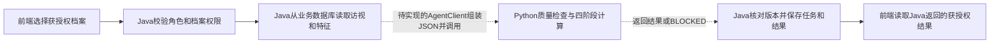

# 研究交付、Git更新与Java取数计算

核对日期：2026-10-26；研究结果截至2026-10-25；已合并main基点`901ed74`（文件树与本地`ace8411`一致），PR #10已合并；后端PR #11与前端PR #12仍未合并。本说明区分离线研究完成、Git交付、模型服务接入和业务联合验收。

本分支交付：已整理[可移植估计器与离线模型验收](Research_Model_Portability.md)，提供七/十变量最终模型的合成加载入口，九最终模型与原实现两原因CIF差0。受控维护主机的原Python工作台另已接入聚合研究审查和九模型合成计算。源码、构造样例/测试及独立依赖随本分支提供；完整历史实验流水线未整体移植，受控参数未发布，面向Java的新模型HTTP契约与业务联调仍未完成。原PR #10仅含业务日修复与聚合说明，不包含本分支新增源码。

## 当前是否完成

以下固定研究任务已经完成，可以按阶段交付，无需等待所有后续研究结束：

| 已完成任务 | 交付范围 | 结论边界 |
| --- | --- | --- |
| 七变量三算法 | LR/RF/XGBoost，原1160人五外折/三内折校准验证，三最终模型和15外折模型 | 校准改善未确立，保留原始研究输出 |
| 七变量解释诊断 | 复用外折模型的置换、训练参考替换与排序一致性 | ADAS13/FAQ全局前二一致，局部及完整排序并不完全稳定 |
| 真实十变量嵌套校准 | 原15外折+3最终模型复用；54内折基础/18校准拟合、18参数保存加载误差0 | RF满足预定内部研究校准保留规则；LR/XGBoost保留原始；默认模型未切换，独立/临床效度未成立 |
| 十变量折外解释 | 复用15外折模型，840次CIF/0拟合；按模态可获得性分层的观测值置换、联合双侧海马、训练参考替换及一致性 | 全局前二集合仍为ADAS13/FAQ；完整排序及局部/跨折并不完全稳定，APOE区间跨0，MRI置换/替换结论不同；不推翻原输入增量比较结论 |
| 遗传/横断MRI增量 | APOE有效428人、双侧海马276人；两个新方案的30外折和6全量模型 | 九项Brier差条件区间均跨0，未确立真实数值稳定增益 |

截至十变量校准阶段，这条算法推进主线累计244次基础拟合、36次校准拟合；基础拟合含15次为嵌套校准交付恢复外折模型的必要重放，不能称244个独立实验；新增54基础拟合均为十变量训练内交叉拟合校准，不重训原18个已交付基础模型。更早历史研究和构造测试不计入此账本。十变量本次解释只有推理与敏感性计算，不增加拟合账本。GAT、独立外部/临床验证、精确历史可获得性、SHAP/LIME与跨重训解释稳健性仍未整体完成，不影响上述固定任务关闭。

本次十变量校准原始→校准Brier：LR .113502→.113087，RF .113830→.112002，XGBoost .109427→.109474。仅RF的校准减原始条件区间不跨0（上限约-0.000040），限固定模型/划分/删失权重，不包含重训和来源不确定性，也没有多重性调整。此内部研究规则不表示算法优越或临床概率精准；本地九模型试算仍为原始输出。

固定训练/嵌套校准源码可移植交付现已完成并关闭：统一编排复用现有估计器、人月/CIF及12个原数值函数，支持从头训练/只校准已有基础模型；27项相关检查、仅源码隔离目录三算法72/18构造拟合、18产物原始/校准两原因CIF误差0。原锁依赖未变，无真实模型重训；历史队列重建、全部比较和解释流水线仍未整体迁移，源码随本分支交付；保存加载核对文件hash、身份元数据及两原因CIF。

第2→3环节[图约束预测机制规格](Graph_Prediction_Protocol.md)及无训练数值参照已完成：十节点、11条旧候选方向、最小三臂（自环/先验/同拓扑语义置换），10项构造检查及源码隔离通过。规格阶段只证明图变化能够通过消息和月危险率到达CIF；四个节点缺跨路由、方向仅为历史假设。当时真实账本244/36、后续54次拟合预算尚未执行；后续已完成原生构造验收和54次真实图研究，当前累计298/36，见下段。个人因果效应仍未识别，不重跑已关闭四边图。

[原生图实现与构造验收](Graph_Native_Acceptance.md)已完成关闭：9项无优化检查、隔离源码9次构造拟合/9产物两原因CIF加载误差0、36项身份错配拒绝通过；三臂同初始化/批次，预处理限训练人月，CPU新环境22包逐版本/hash锁定。该阶段拟合17.612秒、峰值约392MiB；0临床解析/旧模型加载/真实或校准拟合，当时244/36真实账本保持。后续固定1160人三臂图研究已完成，见下段；维护主机已显示学习后图比较和解释聚合结果，入口收敛已实现，实际视觉QA仍未完成。

[固定三臂图研究执行与交付](Graph_Research_Execution.md)现已完成关闭：45外折＋9全量真实基础拟合/0校准，54产物加载两原因CIF误差0；未确立本固定先验路由增量。真实累计298/36，未切换默认或证明个人因果/临床。 原十变量派生CSV只解析一次，0新增原始表/旧模型加载，原数据和模型保持。该图训练阶段之后的解释固定诊断现已完成，见下段；本次真实图训练不冒充Java或临床接通。当前完成状态见[Python需求状态](Python_Requirement_Status.md)。

[图模型实际路径与折外解释](Graph_Explanation_Results.md)固定验收已完成：45外折模型复用、1230次CIF/45追踪、0拟合；两原因贡献重构误差约2.22e-16，实际计算链误差约4.44e-15。贡献明显顺序敏感，先验注意力首位/删边影响首位一致率34.82%（761合格人）；未建立解释唯一性、稳定性或个人因果。真实账本298/36不变，无个人结果输出。本地演示入口已按四环节收敛，唯一下一任务是现有页面的实际浏览器视觉与交互验收（0拟合/0模型加载）；真实Java/临床仍未接通，本次解释结果不扩大用途。

## 能证实的性能改善

下表限同一1160人、同索引/标签/五折；不得把不同451人landmark任务的AUC直接当作起点横比。

| 算法 | 五变量 AUC / Brier | 加ADAS13与FAQ AUC / Brier | 再加APOE及左右海马 AUC / Brier |
| --- | --- | --- | --- |
| LR | .683786 / .141401 | .824558 / .115639 | .844715 / .113502 |
| RF | .645903 / .141438 | .823694 / .116760 | .843509 / .113830 |
| XGBoost | .667905 / .140385 | .843227 / .111855 | .855640 / .109427 |

加入ADAS13/FAQ的三项Brier差条件区间均支持当前快照内改善，误差相对下降约17%–20%。遗传/MRI的增量差区间全部跨0；“只保留新增变量是否缺失”的对照已有相近点估计，不能把AUC上升全部归因于真实测量值。AUC不是准确率，Brier也不是单独的校准证明。

多模态研究仅限明确声明的回顾性存储快照：276条所选MRI中275条RUNDATE晚于索引。扫描在起点前并不能证明后期处理出的数值当时可用；既有历史实时/临床门控保持未成立。原始mm3体积未认证ICV/扫描仪或跨处理版本支持。未据此替换默认模型。

## Git仓库与运行环境分别交付什么

| 内容 | 当前所在范围 | Git交付方式 |
| --- | --- | --- |
| 课程Python服务、客户端与HTTP契约 | 本仓库`python_service/`、`contracts/` | 提交源码、测试、合成例子和团队说明 |
| Java业务后端 | 本仓库`backend/` | 提交Java代码/迁移/测试；拉取更新不自动完成数据库或运行服务部署 |
| 此次离线研究脚本 | 历史实验在受控工作区；本地`research_runtime/`含计算、离线加载、固定训练与嵌套校准 | 源码/构造样例/原依赖锁/测试说明随本分支交付；历史队列构造、全部比较/解释未整体迁移，不能把原聚合说明称为已发布训练代码 |
| ADNI源表、派生个体输入、折成员、个体结果 | 受控研究环境 | 不提交；`.gitignore`只是辅助，提交前仍应检查文件清单 |
| 拟合模型、私有模型清单及运行配置 | 受控研究环境 | 不上传参数文件；需要独立、受控的模型部署与版本核对 |
| 聚合研究结果和限制 | 本说明 | 可交付去除个体内容和机器私有背景的团队说明 |

`git pull`只获取已发布文件，不会获得本地未提交脚本、受控源表或模型权重，也不会让8091自动从演示规则切换到新研究模型。代码提交、模型交付和部署是三个不同操作。发布离线研究源码时，还需整理其工作区路径、依赖及私有证据入口，并用构造数据验证可用范围；不应把整个维护工作区复制进业务仓库，也不应为“提交更新”再跑一遍已完成训练。

## Java如何取得档案数据并请求计算

下面是现有共同契约规定的目标业务流程；其中AgentClient、评估任务和业务结果保存尚待后端实现及联合验收。

1. 档案、访视、特征先通过Java业务接口或CSV预览/确认入库。Java管理数据库和用户权限；Python不登录Java数据库自行抓取患者资料。
2. 发起计算时，Java应再次确认该用户对该档案有相应权限，从数据库读取任务所需字段，固定`dataVersion`、输入快照及`runId`，组装JSON。
3. 对当前课程演示接口，JSON包含`subjectCode`、版本、24个月窗口、`visits`（日期、MMSE、MoCA、CDR-SB等）及`features`（APOE计数、演示MRI值、单位、记录日期等），结构见[合成请求](../contracts/examples/deepagent-v1.request.example.json)。
4. Java通过HTTP调用`POST /api/agent/v1/runs`。Python同步执行质量检查、融合、图/评分和解释，返回结果或明确的BLOCKED/错误；缺失数据不会因上传代码而自动补齐。
5. Java核对请求/结果身份和版本，保存业务任务与结果；患者视图按角色过滤原始分数、图权重和内部轨迹。前端继续只调用Java。

当前后端已实现档案、访视、认证及CSV预览/确认入库；已导入特征可以存在库中，但当前档案详情的`features`仍返回空数组。当前源码没有实际AgentClient与评估任务调用链，因此不能称以上目标已经接通。实际状态以源码和联合验收为准，不能从数据库表或目标OpenAPI推断完成。

## 新训练模型为什么不能直接接现有请求

| 通道 | 已有用途 | 与本次新模型的关系 |
| --- | --- | --- |
| 8091，`deepagent-v1` | DEMO-* / demo-*合成业务演示，固定规则评分 | 当前未加载新LR/RF/XGBoost模型 |
| 可选8092研究服务 | 旧V8模型的专用本机合成请求验收 | 不能自动升级成本次七/十变量模型 |
| 授权主机8084受控工作台 | 既有受控目录/投影的研究计算与客户端 | 不是Java业务数据库，也未自动改用此次新模型 |
| 新七/十变量模型 | 本次离线训练、折外评价与受控模型交付 | 尚未接到上述业务HTTP调用链 |

现有演示请求没有完整表达年龄、教育、全局CDR、ADAS13和FAQ等新模型输入；演示MRI使用`normalized`，研究海马体积使用`mm3`，不能直接互换。演示`riskScore`和研究24月CIF的含义也不同，不能沿用同一模型版本静默替换计算器。

后续真实接入需先协调版本化研究契约、字段/单位/测量日/可获得日/来源/QC、资格和缺失规则、模型选择与校准状态，再在受控环境提供推理服务，由Java实现适配、权限、持久化及失败处理并完成联合验收。该过程只在明确新任务范围内推进，不借本说明新增API、放开DEMO限制或自动部署临床模型。

已有接口与边界详见[Java/Python约定](Integration_Contract.md)、[可选研究服务](Research_Runtime_Integration.md)和[受控工作台客户端](Controlled_Research_Client.md)。
